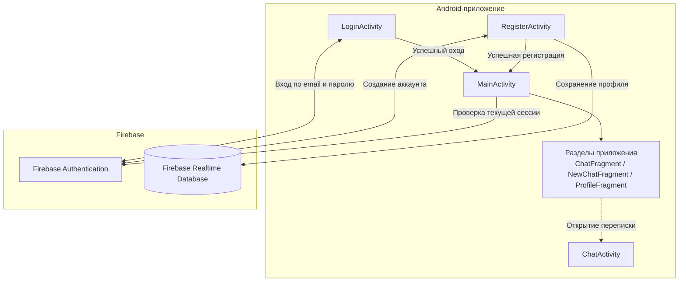

<div align="center">

# Android Messenger

### Простой способ оставаться на связи.

Нативное Android-приложение для обмена сообщениями. Проект создан на Kotlin с использованием Android SDK и сервисов Firebase.

**Kotlin · Android SDK · Firebase Authentication · Firebase Realtime Database**

[](https://kotlinlang.org/)
[](https://developer.android.com/)
[](https://firebase.google.com/)
[](https://gradle.org/)
[](https://developer.android.com/studio)

[Возможности](#-возможности) · [Архитектура](#-архитектура) · [Технологии](#-технологический-стек) · [Установка](#-установка-и-настройка) · [Тестирование](#-тестирование)

</div>

---

## 📌 О проекте

**Android Messenger** — учебный проект нативного Android-приложения, в котором реализованы базовые сценарии регистрации и авторизации пользователей с помощью Firebase Authentication, а также сохранение пользовательских данных в Firebase Realtime Database.

Клиентская часть написана на **Kotlin** с использованием Android SDK, XML-разметки и View Binding. Навигационная основа приложения построена на Activity и Fragment, а Firebase используется как облачная инфраструктура для работы с учётными записями и данными.

Проект демонстрирует практическую работу с:

- нативной Android-разработкой на Kotlin;
- жизненным циклом Activity;
- XML-разметкой и View Binding;
- обработкой пользовательского ввода;
- асинхронными операциями Firebase;
- аутентификацией и хранением данных в облачной базе.

> **Состояние репозитория:** в текущей версии GitHub представлены не все исходные файлы приложения. В частности, отсутствуют исходники некоторых экранов и компонентов чата, на которые ссылаются имеющиеся файлы. Поэтому ниже отдельно отмечены возможности, подтверждённые доступным исходным кодом, и части, которые нельзя полноценно проверить по текущему содержимому репозитория.

## ✨ Возможности

### 🔐 Регистрация и авторизация

- Регистрация пользователя по электронной почте и паролю через Firebase Authentication.
- Ввод имени пользователя при создании аккаунта.
- Авторизация существующего пользователя.
- Проверка заполненности обязательных полей перед отправкой данных.
- Проверка текущей Firebase-сессии при открытии главного экрана.

### 👤 Данные пользователя

После успешной регистрации приложение сохраняет в Firebase Realtime Database запись пользователя с полями:

| Поле | Назначение |
|---|---|
| `email` | Электронная почта пользователя |
| `username` | Имя пользователя |
| `chats` | Начальное значение поля со списком чатов |

Запись создаётся в узле `Users/{uid}`, где `uid` — идентификатор пользователя из Firebase Authentication.

### 🧭 Навигация приложения

В `MainActivity` предусмотрена нижняя навигация с тремя разделами:

- **Чаты** — `ChatFragment`.
- **Новый чат** — `NewChatFragment`.
- **Профиль** — `ProfileFragment`.

Также в Android Manifest объявлена отдельная `ChatActivity`.

**Важно:** исходники перечисленных фрагментов и `ChatActivity` отсутствуют в текущем GitHub-снимке репозитория. Их назначение можно определить по названиям и ссылкам из проекта, но внутреннюю логику, сценарии обмена сообщениями и синхронизацию переписки по доступному исходному коду подтвердить нельзя.

## 🧰 Технологический стек

| Область | Технологии |
|---|---|
| Язык программирования | Kotlin 2.1.0 |
| Платформа | Android SDK 35 |
| Минимальная версия Android | Android 8.0 (API 26) |
| Целевая версия Android | Android 15 (API 35) |
| Сборка | Gradle 8.10.2, Android Gradle Plugin 8.8.0 |
| UI | XML Layouts, Android Views |
| Привязка UI | View Binding |
| Навигация | Activity, Fragment |
| UI-компоненты | AndroidX, Material Components, ConstraintLayout |
| Авторизация | Firebase Authentication |
| Облачная база данных | Firebase Realtime Database |
| Аналитика | Firebase Analytics |
| Загрузка изображений | Glide 4.16.0 |
| Круглые изображения | CircleImageView 3.1.0 |
| Тестирование | JUnit 4, AndroidX JUnit, Espresso |

### Основные зависимости

| Библиотека | Версия | Назначение |
|---|---:|---|
| Kotlin | 2.1.0 | Основной язык разработки |
| Android Gradle Plugin | 8.8.0 | Сборка Android-приложения |
| Gradle | 8.10.2 | Система сборки |
| Firebase BOM | 33.10.0 | Управление версиями Firebase SDK |
| Firebase Authentication | 23.2.0 | Регистрация и вход |
| Firebase Realtime Database | 21.0.0 | Работа с облачными данными |
| Firebase Analytics | 22.3.0 | Инструменты аналитики |
| Glide | 4.16.0 | Загрузка и отображение изображений |
| CircleImageView | 3.1.0 | Отображение круглых изображений |
| Material Components | 1.12.0 | Компоненты Material Design |
| ConstraintLayout | 2.2.0 | Построение интерфейсов |

Версии указаны по конфигурации проекта в `gradle/libs.versions.toml` и `app/build.gradle.kts`.

## 🏗️ Архитектура

Приложение использует нативную Android-архитектуру на основе Activity и Fragment. Взаимодействие с Firebase выполняется непосредственно из экранов приложения через соответствующие SDK.

### Общая схема



> Пунктирная связь с `ChatActivity` показывает объявленный в проекте экран, а не подтверждённый исходниками сценарий перехода. Реализация фрагментов и переписки не представлена в текущем репозитории.

### Регистрация пользователя

1. Пользователь открывает экран регистрации.
2. Приложение получает email, пароль и имя пользователя из полей формы.
3. Проверяется, что обязательные поля заполнены.
4. `FirebaseAuth.createUserWithEmailAndPassword()` создаёт учётную запись.
5. После успешной регистрации приложение получает UID созданного пользователя.
6. В Firebase Realtime Database сохраняются email, имя пользователя и начальное поле `chats`.
7. Открывается главный экран приложения.

### Авторизация пользователя

1. Пользователь вводит email и пароль.
2. Приложение проверяет заполненность полей.
3. `FirebaseAuth.signInWithEmailAndPassword()` отправляет запрос на авторизацию.
4. При успешном входе открывается `MainActivity`.
5. Главный экран проверяет наличие текущего пользователя через `FirebaseAuth.currentUser`.

## 📁 Структура проекта

Ниже показана структура исходных файлов, которые присутствуют в текущем GitHub-репозитории. Сгенерированные файлы из `app/build/` намеренно не включены в дерево.

```text
AndroidMessenger/
├── app/
│   ├── src/
│   │   ├── androidTest/
│   │   │   └── java/com/example/androidmessenger/
│   │   │       └── ExampleInstrumentedTest.kt
│   │   ├── main/
│   │   │   ├── java/com/example/androidmessenger/
│   │   │   │   ├── LoginActivity.kt
│   │   │   │   ├── RegisterActivity.kt
│   │   │   │   └── MainActivity.kt
│   │   │   ├── res/
│   │   │   │   ├── drawable/       # Изображения и векторные ресурсы
│   │   │   │   ├── font/           # Шрифты Ubuntu
│   │   │   │   ├── layout/         # XML-разметка экранов
│   │   │   │   ├── mipmap-*/       # Иконки приложения
│   │   │   │   ├── values/         # Строки и темы
│   │   │   │   ├── values-night/  # Ночная тема
│   │   │   │   └── xml/            # Правила резервного копирования
│   │   │   └── AndroidManifest.xml
│   │   └── test/
│   │       └── java/com/example/androidmessenger/
│   │           └── ExampleUnitTest.kt
│   ├── build.gradle.kts
│   ├── google-services.json
│   └── proguard-rules.pro
├── gradle/
│   ├── libs.versions.toml
│   └── wrapper/
│       └── gradle-wrapper.properties
├── build.gradle.kts
├── gradle.properties
├── settings.gradle.kts
├── gradlew
├── gradlew.bat
└── .gitignore
```

### Назначение основных компонентов

| Компонент | Ответственность |
|---|---|
| `LoginActivity` | Авторизация пользователя через Firebase Authentication |
| `RegisterActivity` | Создание аккаунта и сохранение данных пользователя |
| `MainActivity` | Проверка текущей сессии и настройка нижней навигации |
| `activity_login.xml` | Разметка экрана входа |
| `activity_register.xml` | Разметка экрана регистрации |
| `activity_main.xml` | Контейнер фрагментов и нижняя навигация |
| `AndroidManifest.xml` | Регистрация Activity и разрешений приложения |
| `libs.versions.toml` | Централизованное управление версиями зависимостей |

## 🚀 Установка и настройка

### Необходимое программное обеспечение

- [Android Studio](https://developer.android.com/studio).
- JDK 17 или совместимая с используемой версией Android Gradle Plugin среда.
- Android SDK 35.
- Android Emulator или физическое Android-устройство.
- Аккаунт [Firebase](https://firebase.google.com/).

### 1. Клонирование репозитория

```bash
git clone https://github.com/BeneFIT124/AndroidMessenger.git
cd AndroidMessenger
```

### 2. Настройка Firebase

Приложение использует Firebase Authentication и Firebase Realtime Database.

Для настройки собственного Firebase-проекта:

1. Создайте проект в [Firebase Console](https://console.firebase.google.com/).
2. Добавьте Android-приложение с package name `com.example.androidmessenger`.
3. Скачайте файл конфигурации `google-services.json`.
4. Поместите его в директорию `app/`.
5. В разделе **Authentication → Sign-in method** включите способ входа **Email/Password**.
6. Создайте базу данных в разделе **Realtime Database**.
7. Настройте правила доступа к базе данных с учётом UID авторизованного пользователя.

Пример расположения файла:

```text
AndroidMessenger/
└── app/
    └── google-services.json
```

В репозитории уже присутствует `app/google-services.json`, связанный с существующей конфигурацией Firebase. Для собственного окружения рекомендуется использовать конфигурационный файл своего проекта.

**Безопасность:** не публикуйте приватные ключи сервисных аккаунтов, закрытые ключи и другие серверные секреты. Правила Firebase Realtime Database должны ограничивать доступ к пользовательским данным.

### 3. Синхронизация и запуск

Откройте проект через Android Studio и дождитесь завершения Gradle Sync.

Для сборки debug-версии из корня проекта:

```bash
./gradlew assembleDebug
```

В Windows:

```bat
gradlew.bat assembleDebug
```

При успешной сборке APK обычно располагается по пути:

```text
app/build/outputs/apk/debug/app-debug.apk
```

> **Важное ограничение текущей версии репозитория:** команда сборки из чистого клона может завершиться ошибкой. В `MainActivity.kt` импортируются `ChatFragment`, `NewChatFragment` и `ProfileFragment`, а в `AndroidManifest.xml` объявлена `ChatActivity`, однако соответствующие исходники отсутствуют в GitHub. Также в исходном дереве не найден ресурс меню нижней навигации, на который ссылается `activity_main.xml`. Для воспроизводимой сборки необходимо добавить недостающие Kotlin-файлы и ресурсы в репозиторий.

## 🧪 Тестирование

В проекте присутствуют базовые шаблоны тестирования:

| Тип | Инструмент | Текущее содержимое |
|---|---|---|
| Unit-тесты | JUnit 4 | Пример проверки сложения `2 + 2` |
| Instrumented-тесты | AndroidX JUnit, Espresso | Проверка package name приложения |

Запуск unit-тестов:

```bash
./gradlew test
```

Запуск instrumented-тестов на подключённом устройстве или эмуляторе:

```bash
./gradlew connectedAndroidTest
```

Эти тесты являются стартовыми шаблонами Android Studio и не проверяют полноценные сценарии регистрации, авторизации или обмена сообщениями.

## 🛠️ Что стоит улучшить

Это направления дальнейшей работы, а не описание уже реализованной функциональности:

- Восстановить и добавить в GitHub все исходники экранов чатов, профиля, адаптеров и моделей.
- Завершить и проверить сценарии отправки, получения и обновления сообщений в Firebase Realtime Database.
- Добавить обработку ошибок Firebase и понятные сообщения пользователю.
- Добавить валидацию email и требований к паролю.
- Реализовать корректное управление навигацией и жизненным циклом экранов.
- Написать unit- и instrumented-тесты для основных пользовательских сценариев.
- Удалить из Git-репозитория сгенерированные build-артефакты и настроить `.gitignore`, чтобы не блокировать добавление исходников.

## 👨‍💻 Автор

**BeneFIT124** — автор проекта.

- GitHub: [@BeneFIT124](https://github.com/BeneFIT124)
- Репозиторий: [AndroidMessenger](https://github.com/BeneFIT124/AndroidMessenger)

---

<div align="center">

**Android Messenger — практика нативной Android-разработки на Kotlin.**

</div>
